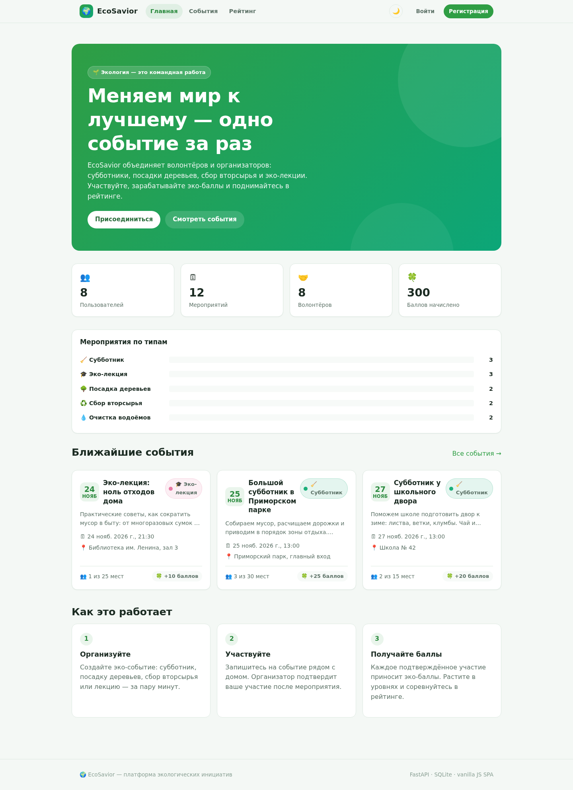
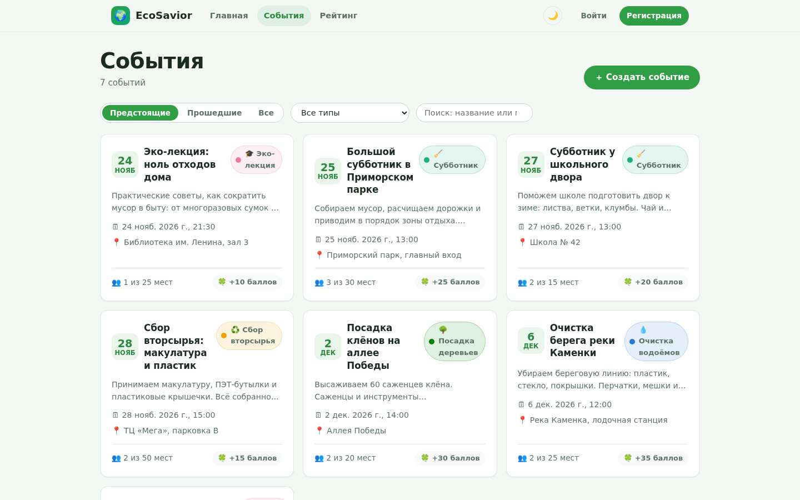
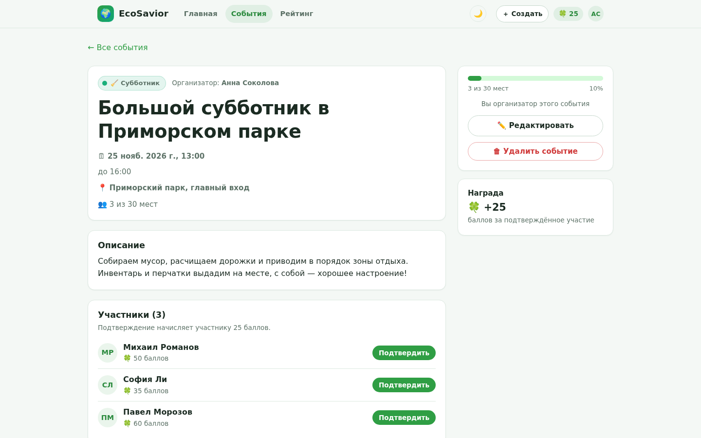
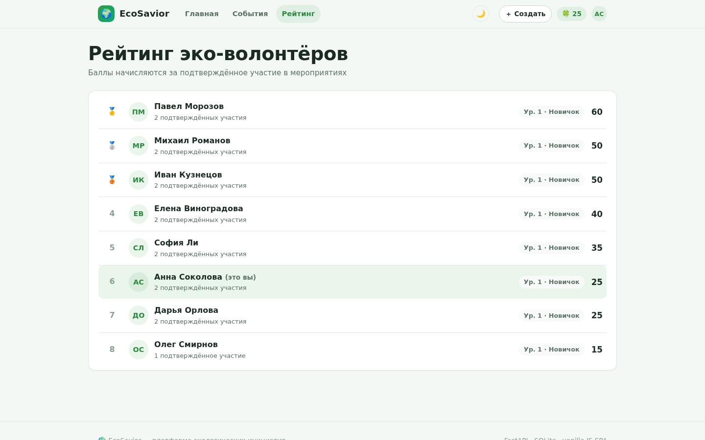
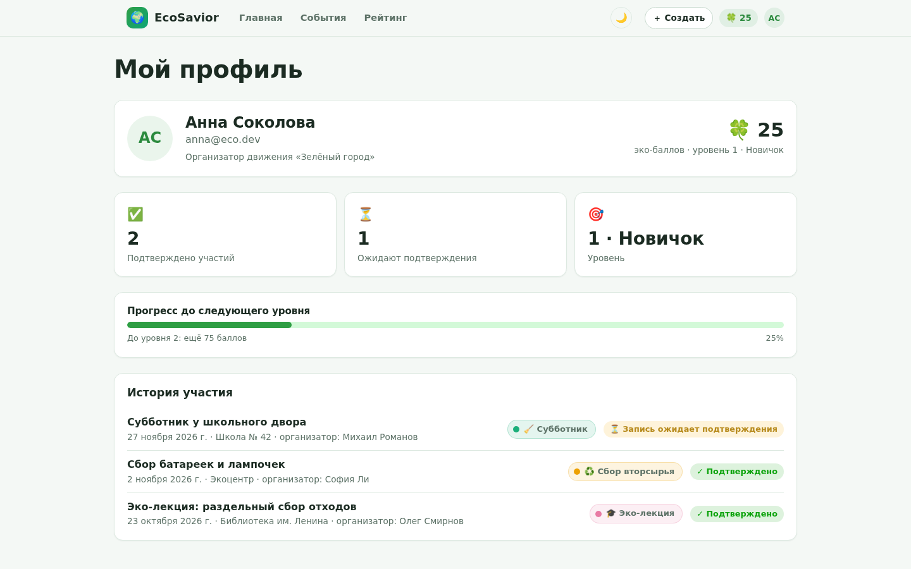
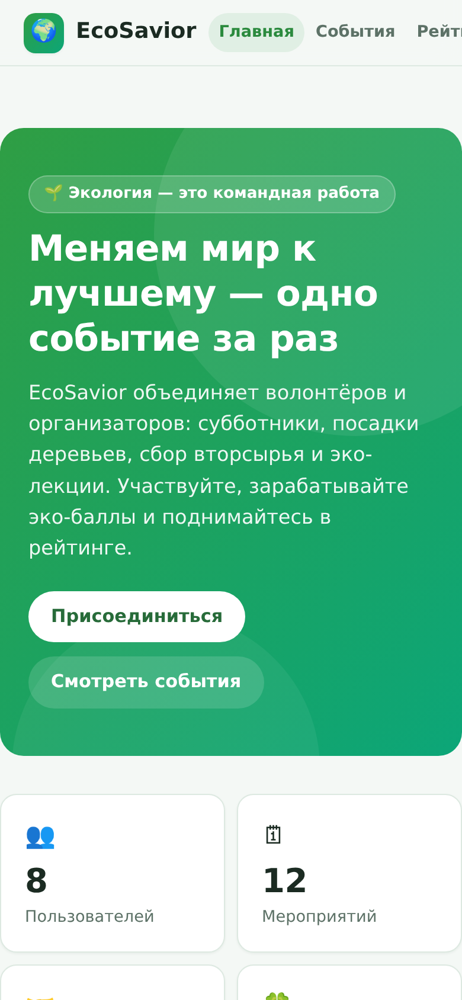

# 🌍 EcoSavior — платформа экологических инициатив

Клиент-серверное приложение с REST API и авторизацией: организаторы публикуют
эко-события (субботники, посадки деревьев, сбор вторсырья, эко-лекции, очистка
водоёмов), волонтёры записываются, а за подтверждённое участие получают
эко-баллы, растут в уровнях и соревнуются в рейтинге.

## Почему выбран тип «Клиент-серверное приложение с REST API и авторизацией»

- **Многопользовательский сценарий требует сервера.** События создают одни
  пользователи, на них записываются другие — нужны общая БД, согласованное
  состояние и разграничение прав (организатор / участник).
- **Авторизация критична для честного учёта баллов.** Эко-баллы начисляются за
  подтверждённое участие, поэтому важно надёжно аутентифицировать пользователя
  и защитить токены: JWT access-токен + refresh-токен с ротацией.
- **REST API — расширяемая точка интеграции.** Тот же API могут использовать
  мобильные клиенты, боты и сторонние сервисы; автодокументация OpenAPI
  доступна на `/docs`.
- **Тема актуальна.** Геймификация волонтёрства — рабочий приём вовлечения
  людей в экологическую повестку (ср. «Добро.рф», эко-квесты городов).

## Функциональность

- Регистрация и вход; JWT access (15 мин) + refresh (30 дней) с ротацией и
  детектом повторного использования токена
- Создание, редактирование и удаление событий (только организатор)
- Лента событий: фильтры по типу, поиск, периоды (предстоящие/прошедшие),
  пагинация
- Запись на событие и отмена; проверка вместимости и статуса события
- Подтверждение участия организатором → начисление эко-баллов (ровно один раз)
- Рейтинг участников, уровни и звания («Новичок» → «Хранитель планеты»)
- Публичные профили, личный кабинет с историей участия и прогрессом уровня
- Сводная статистика платформы, светлая/тёмная тема, адаптивная вёрстка

## Стек

| Слой | Технологии |
|---|---|
| Бэкенд | Python 3.12, FastAPI, SQLAlchemy 2.0 (ORM), SQLite |
| Валидация | Pydantic v2 |
| Авторизация | PyJWT (HS256), bcrypt, refresh-токены в БД с ротацией |
| Безопасность | CSP и security-заголовки, CORS, rate limiting (slowapi) |
| Фронтенд | Vanilla JS SPA (без сборки и Node): hash-роутер, fetch-клиент с автообновлением токена |
| Тесты | pytest + httpx (35 тестов API) |
| Демо | Playwright (скриншоты, видео), imageio-ffmpeg |

## Структура проекта

```
project-root/
├── README.md              ← этот файл
├── PROMPTS.md             ← дневник промптов (ключевой артефакт)
├── REFLECTION.md          ← рефлексия: что удалось / не удалось
├── requirements.txt       ← зависимости (runtime)
├── requirements-dev.txt   ← зависимости (тесты + демо)
├── pyproject.toml         ← конфигурация pytest
├── .env.example
├── src/
│   ├── main.py            ← точка входа: FastAPI-приложение
│   ├── config.py          ← настройки (env)
│   ├── db.py              ← engine, сессии, кастомная SQL-функция lower_utf8
│   ├── models.py          ← модели SQLAlchemy (users, events, participants, refresh_tokens)
│   ├── schemas.py         ← Pydantic-схемы
│   ├── security.py        ← bcrypt, JWT
│   ├── deps.py            ← get_current_user / get_optional_user
│   ├── errors.py          ← единый формат ошибок { error: { code, message, details } }
│   ├── levels.py          ← уровни и звания
│   ├── seed.py            ← демо-данные (python -m src.seed)
│   ├── routers/           ← auth, events, me, users, misc
│   ├── services/          ← auth_service, event_service (бизнес-логика)
│   └── static/            ← SPA: index.html, css/, js/ (views, api, router)
├── tests/                 ← 35 тестов: auth, events, рейтинг, статистика
├── scripts/
│   └── capture.py         ← скриншоты и демо-видео (Playwright)
└── docs/
    ├── screenshots/       ← 8 скриншотов работающего приложения
    ├── demo.mp4           ← видео-демонстрация (~32 сек)
    └── architecture.md    ← архитектура и ключевые решения
```

## Быстрый старт

```bash
# 1. Виртуальное окружение
python3 -m venv .venv && source .venv/bin/activate
# (или через uv: uv venv .venv && source .venv/bin/activate)

# 2. Зависимости
pip install -r requirements-dev.txt

# 3. Демо-данные (8 пользователей, 12 мероприятий)
python -m src.seed

# 4. Запуск (http://localhost:4000)
uvicorn src.main:app --port 4000
# режим разработки с авто-перезагрузкой:
# uvicorn src.main:app --port 4000 --reload
```

Демо-вход организатора: **anna@eco.dev / Demo1234!** (у всех демо-пользователей
этот же пароль).

### Тесты

```bash
pytest            # 35 тестов: auth, события, запись, подтверждение, рейтинг
```

### Скриншоты и демо-видео

```bash
# при запущенном сервере:
python scripts/capture.py   # → docs/screenshots/*.png + docs/demo.mp4
```

## REST API

Документация OpenAPI: **http://localhost:4000/docs**

| Метод | Путь | Описание | Доступ |
|---|---|---|---|
| POST | `/api/v1/auth/register` | Регистрация | публичный |
| POST | `/api/v1/auth/login` | Вход | публичный |
| POST | `/api/v1/auth/refresh` | Ротация refresh-токена | refresh-токен |
| POST | `/api/v1/auth/logout` | Выход (отзыв refresh) | refresh-токен |
| GET | `/api/v1/auth/me` | Текущий пользователь | Bearer |
| PATCH | `/api/v1/me` | Обновление профиля | Bearer |
| GET | `/api/v1/me/events` | История участия | Bearer |
| GET | `/api/v1/users/{id}` | Публичный профиль | публичный |
| GET | `/api/v1/events` | Список (`type`, `q`, `scope`, `page`, `limit`) | публичный* |
| POST | `/api/v1/events` | Создать событие | Bearer |
| GET | `/api/v1/events/{id}` | Детали + участники | публичный* |
| PATCH/DELETE | `/api/v1/events/{id}` | Изменить/удалить | организатор |
| POST/DELETE | `/api/v1/events/{id}/join` | Записаться / отменить запись | Bearer |
| POST | `/api/v1/events/{id}/participants/{uid}/confirm` | Подтвердить участие (+баллы) | организатор |
| GET | `/api/v1/leaderboard` | Рейтинг | публичный |
| GET | `/api/v1/stats` | Статистика платформы | публичный |
| GET | `/api/v1/health` | Проверка здоровья | публичный |

\* с Bearer-токеном дополнительно возвращается флаг `joined`.

Формат ошибок единый: `{ "error": { "code": "EVENT_FULL", "message": "…", "details": […] } }`.

## Как устроена авторизация

1. Пароль хранится как bcrypt-хеш (10 раундов), в ответах не фигурирует.
2. `access` — короткоживущий JWT (15 мин) в заголовке `Authorization: Bearer`.
3. `refresh` — JWT (30 дней), хранится в БД только как SHA-256-хеш; при каждом
   использовании **ротируется** (старый отзывается, выдаётся новый).
4. Повторное использование уже отозванного refresh-токена трактуется как
   компрометация: **все сессии пользователя отзываются** (защита от кражи).
5. Клиент при 401 автоматически обновляет access-токен (single-flight) и
   повторяет исходный запрос.

## Уровни и баллы

Уровень `L` требует `(L−1)² × 100` баллов: 100 → 2, 400 → 3, 900 → 4, 1600 → 5.
Звания: Новичок (1), Активист (2–3), Эко-боец (4–5), Хранитель планеты (6+).

## Скриншоты

| Главная | Лента событий |
|---|---|
|  |  |

| Детали события (организатор) | Рейтинг |
|---|---|
|  |  |

| Профиль | Мобильная версия |
|---|---|
|  |  |

Видео-демонстрация: [docs/demo.mp4](docs/demo.mp4) (~32 сек: вход, подтверждение
участия, рейтинг, создание события, профиль).

## Ключевые технические решения

- **Даты — строки ISO 8601 в UTC.** SQLite сравнивает и сортирует их
  лексикографически корректно, а проблемы таймзон не возникают в принципе.
- **Цветовая палитра UI валидирована** на дальтонизм и контраст (OKLab ΔE,
  скрипт-валидатор); цвета типов событий всегда дублируются иконкой и текстом.
- **CSP без `unsafe-eval`** — инлайн-скрипты заблокированы, весь JS в файлах.
- **In-memory SQLite в тестах** — полная изоляция, нет побочных эффектов.
- **SPA без сборки** — статику раздаёт FastAPI, никакого Node и бандлеров.

## Возможные улучшения

- Docker Compose (api + volume), PostgreSQL для production
- CI (GitHub Actions: pytest + линтер)
- Уведомления (email) о новых событиях, карта событий
- `SELECT … FOR UPDATE` для конкурентных записей и подтверждений
