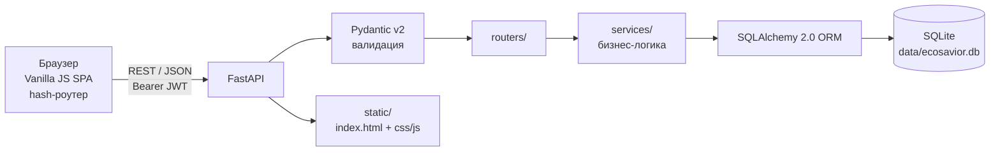
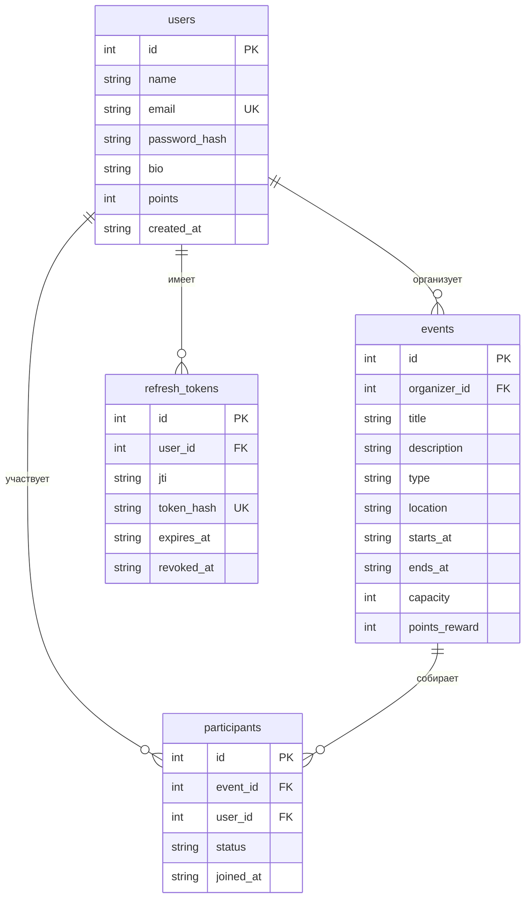
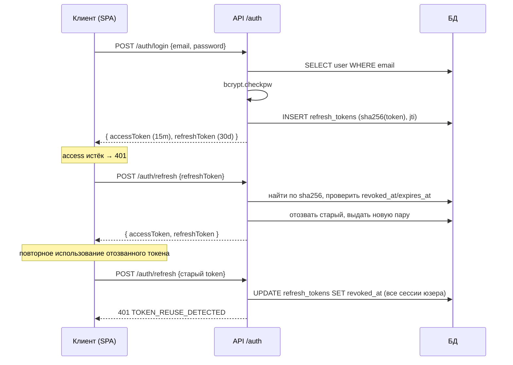

# Архитектура EcoSavior

## Компоненты

- **SPA** — статика без сборки; клиентский роутинг на хешах (`#/events/3`),
  поэтому серверу не нужен SPA-fallback — он всегда отдаёт `index.html`.
- **Routers** — тонкий слой: маршруты, зависимости, response-модели.
- **Services** — вся бизнес-логика (регистрация, запись, подтверждение,
  начисление баллов). Слой отделён от HTTP — легко переиспользовать.
- **Ошибки** — единый формат `{error: {code, message, details}}` через
  `ApiError` + обработчики FastAPI (см. `src/errors.py`).

## Схема БД

Все даты — **строки ISO 8601 в UTC** (без суффикса таймзоны). Причина: SQLite
хранит datetime без таймзоны, и сравнение aware/naive объектов — классический
источник багов; строки сравниваются и сортируются лексикографически корректно,
а конвертация происходит только на границе API (схемы Pydantic).

## Поток авторизации

## Подтверждение участия и баллы

`POST /events/{id}/participants/{uid}/confirm` (только организатор):

1. Проверки: событие существует, вызывающий — организатор (403 иначе),
   запись существует (404), статус ещё `joined` (409 при повторе).
2. В одной транзакции: `status = confirmed` и `user.points += points_reward`.
3. Ответ содержит начисленные баллы и обновлённый уровень участника.

Уровни: `level = 1 + ⌊√(points/100)⌋`, звания по уровню.

## Безопасность

| Механизм | Реализация |
|---|---|
| Пароли | bcrypt, 10 раундов; максимум 72 символа (ограничение bcrypt) |
| Токены | JWT HS256; refresh хранится в БД только как SHA-256-хеш |
| Ротация | refresh одноразовый; reuse → отзыв всех сессий |
| CSP | `script-src 'self'` без `unsafe-inline`/`unsafe-eval` (для `/docs` — исключение, там CDN) |
| Rate limit | slowapi: 30 req/мин на `/api/v1/auth/*` |
| CORS | настраивается через `CORS_ORIGINS` |
| Заголовки | `X-Content-Type-Options`, `X-Frame-Options`, `Referrer-Policy` |

## Цвет и визуализация (принятые решения)

- Диаграмма «Мероприятия по типам» — **рейтинговые горизонтальные бары одним
  оттенком** (сравнение величин, а не различение серий).
- Цвета типов событий — категориальная палитра, **валидированная скриптом** на
  CVD-различимость (OKLab ΔE ≥ 8) и контраст в обеих темах; идентичность типа
  всегда дублируется иконкой и текстом (цвет не единственный канал).
- Статусные цвета (good/warning/critical) зарезервированы и не используются
  как «цвета серий».
- KPI-тайлы — числа с автокомпактом (1 284 / 12.9K), метры — трек светлее
  заливки (та же рампа).

## Тесты

`tests/` — 35 тестов на `httpx`-клиенте FastAPI с **in-memory SQLite**
(`StaticPool`) на каждый тест: полная изоляция, lifespan приложения не
запускается (реальная БД не затрагивается). Покрытие: регистрация/вход,
валидация, ротация и компрометация токенов, CRUD событий, права организатора,
запись/отмена, вместимость, начисление баллов ровно один раз, рейтинг,
статистика, профили.
